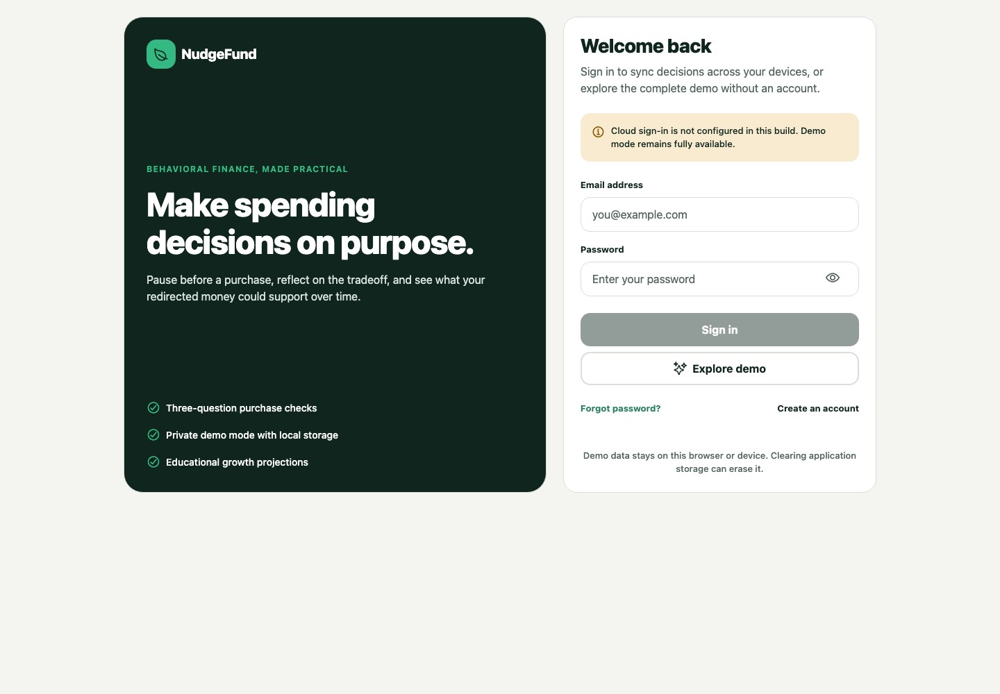
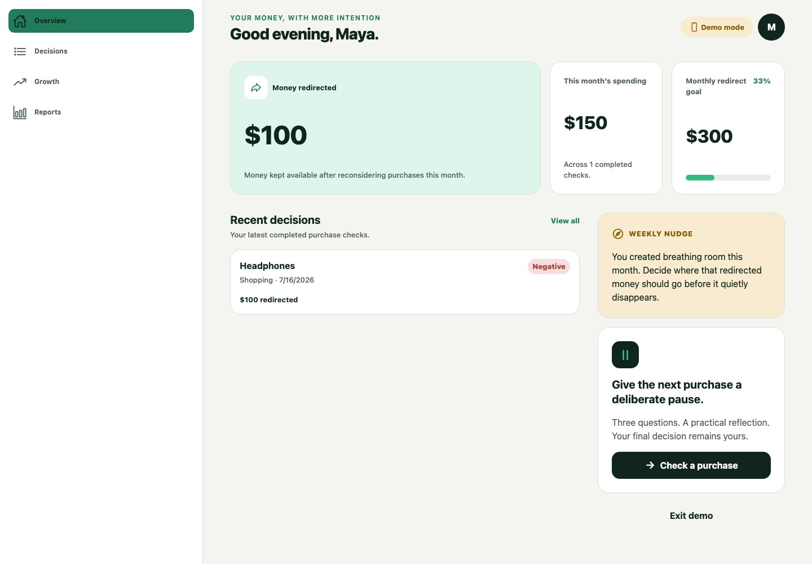
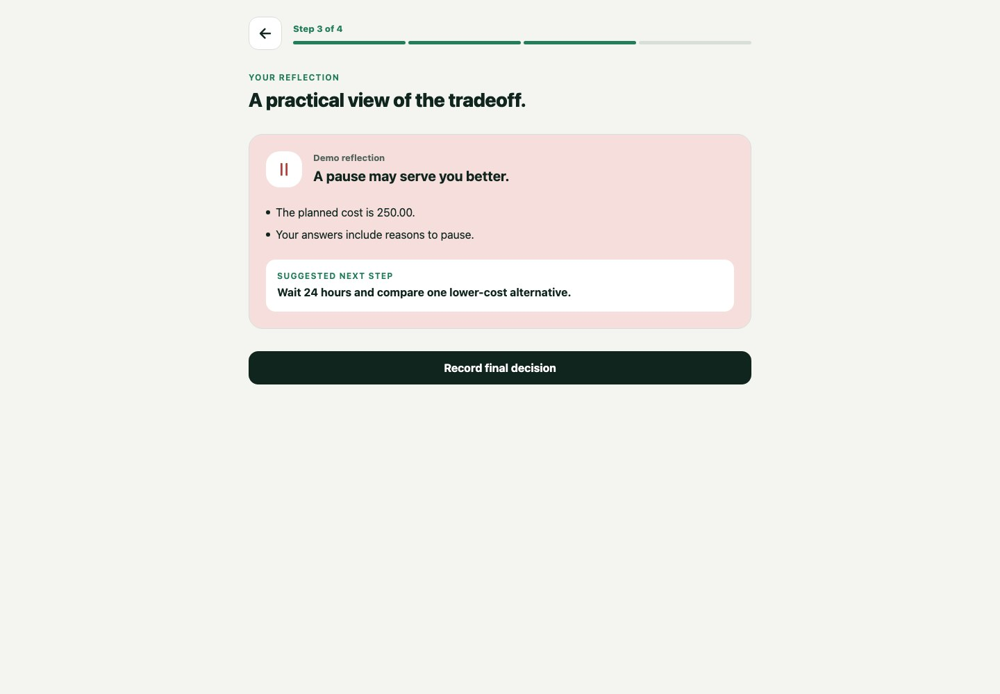
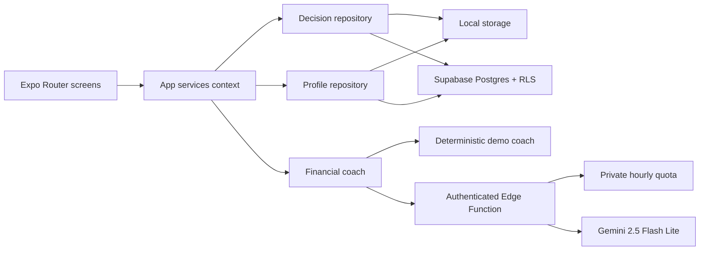

<div align="center">
  
  <h1>NudgeFund</h1>
  <p>A behavioral-finance app that helps you pause before discretionary purchases, record the final outcome, and explore what redirected money could support over time.</p>
</div>


NudgeFund runs on web, iOS, and Android from one Expo codebase. Reviewers can use the complete demo without credentials. Connected mode adds Supabase authentication, cross-device persistence, row-level security, and Gemini coaching through an authenticated Edge Function.

> Deployment status: the repository is ready for deployment, but it does not claim a live production URL. Connected mode requires your own Supabase project and Gemini API key.

## Product

| Sign in or use the local demo | Review your monthly decisions |
| --- | --- |
|  |  |

| Complete a four-step purchase check |
| --- |
|  |

The core flow:

1. Enter a planned purchase and amount.
2. Answer three questions about need, alternatives, and tradeoffs.
3. Review a practical coaching response.
4. Record the final item and amount.

The dashboard then tracks final spending, money redirected, goal progress, recent decisions, growth scenarios, and a monthly report.

## Two operating modes

| Mode | Account | Storage | Coaching |
| --- | --- | --- | --- |
| Demo | Not required | Browser or device only | Deterministic local responses |
| Connected | Supabase email/password | Postgres with RLS | Authenticated Gemini Edge Function with local fallback |

Demo mode keeps data on the current browser or device. Clearing application storage can erase it. No Gemini request or cloud sync occurs in demo mode.

## Architecture



Screens depend on repository and coaching interfaces. They do not import Supabase directly. The same UI works with local adapters in demo mode and Supabase adapters in connected mode.

Read [docs/ARCHITECTURE.md](docs/ARCHITECTURE.md) for the request flow, trust boundaries, and data model.

## Engineering highlights

- Expo Router with responsive web, iOS, Android, tablet, and dark-mode layouts
- Supabase email authentication and portable session persistence
- Postgres migrations with explicit grants and user-scoped row-level security
- Private AI usage events and a 12-request rolling hourly limit
- Gemini key isolated in Edge Function secrets
- Stable validation for AI inputs and structured outputs
- Deterministic offline coaching when AI or the network is unavailable
- Repository adapters for local and connected persistence
- Static web export and Vercel configuration
- Jest, React Native Testing Library, ESLint, TypeScript, Expo Doctor, Deno checks, and GitHub Actions

## Stack

- Expo 57, React Native 0.86, React 19, TypeScript 6
- Expo Router and React Navigation
- Supabase Auth, Postgres, RLS, and Edge Functions
- Gemini 2.5 Flash Lite through `@google/genai`
- Jest Expo and React Native Testing Library

## Run the demo locally

Requirements:

- Node.js 22
- npm

```bash
git clone https://github.com/shlokbhutani13/nudgefund.git
cd nudgefund/react-expo-app
npm ci
npm run web
```

Open the URL printed by Expo and choose **Explore demo**. No environment variables are required.

Native options:

```bash
npm run ios
npm run android
```

## Enable connected mode

Create a Supabase project that you control. Do not reuse another contributor's project or credentials.

```bash
cd react-expo-app
cp .env.example .env.local
```

Set the public client values:

```dotenv
EXPO_PUBLIC_SUPABASE_URL=https://YOUR_PROJECT.supabase.co
EXPO_PUBLIC_SUPABASE_PUBLISHABLE_KEY=YOUR_PUBLISHABLE_KEY
```

From the repository root, link your project and apply the backend only when you intend to deploy it:

```bash
npx supabase login
npx supabase link --project-ref YOUR_PROJECT_REF
npx supabase db push
npx supabase secrets set \
  GEMINI_API_KEY=YOUR_GEMINI_KEY \
  GEMINI_MODEL=gemini-2.5-flash-lite
npx supabase functions deploy financial-coach
```

The client never receives the Gemini key or a privileged Supabase key.

See [DEPLOYMENT.md](DEPLOYMENT.md) for the full release sequence and credentialed smoke test.

## Verify the project

```bash
cd react-expo-app
npm ci
npm audit --omit=dev --audit-level=high
npx expo-doctor
npm test
npm run lint
npm run typecheck
npm run test:e2e
```

Check the Edge Function from the repository root:

```bash
deno check supabase/functions/financial-coach/index.ts
```

The current suite covers domain calculations, validation, auth modes, local and Supabase repositories, AI contracts, quota security, login, dashboard, purchase completion, reports, desktop flow, mobile overflow, dark mode, and reduced motion.

## Security and privacy

- Never commit `.env.local`, Supabase secret keys, service-role keys, or Gemini keys.
- Treat any key committed in earlier history as compromised and revoke it.
- Demo data stays on the current device.
- Connected data uses Supabase RLS so users can access only their own profile and decisions.
- NudgeFund provides educational information. It does not provide investment, tax, legal, or individualized financial advice.

Read [SECURITY.md](SECURITY.md) and [docs/PRIVACY.md](docs/PRIVACY.md) before operating a public instance.

## Contributors

Built by **Rahul Rajkumar** and **Shlok Bhutani**.

Rahul created the original concept and early implementation. Shlok led the current security, architecture, product, testing, and deployment-readiness rebuild.

## License

[MIT](LICENSE)
