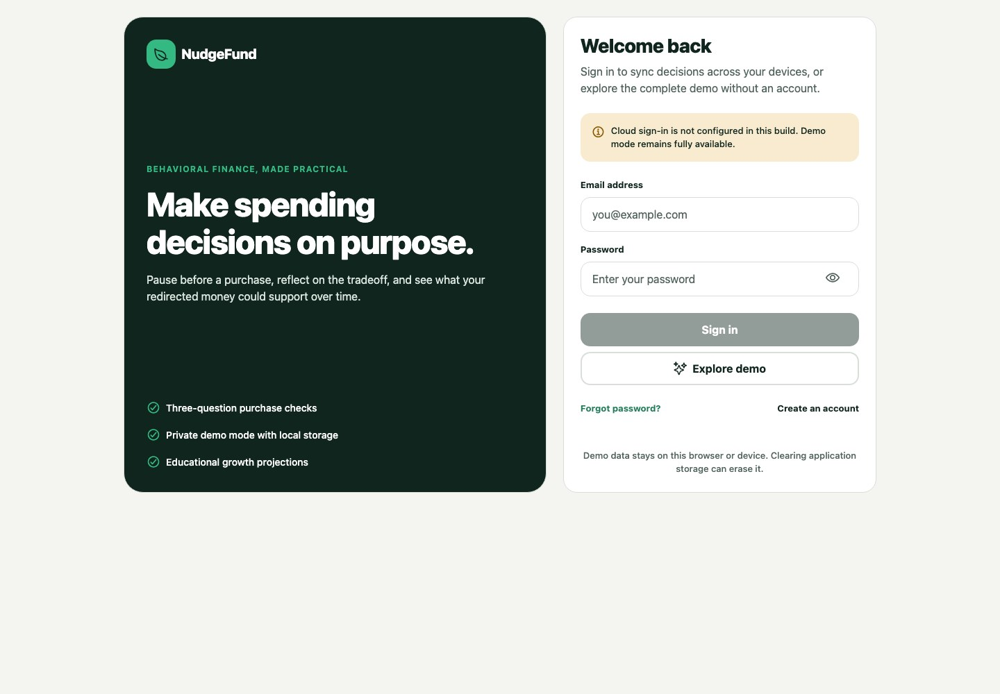
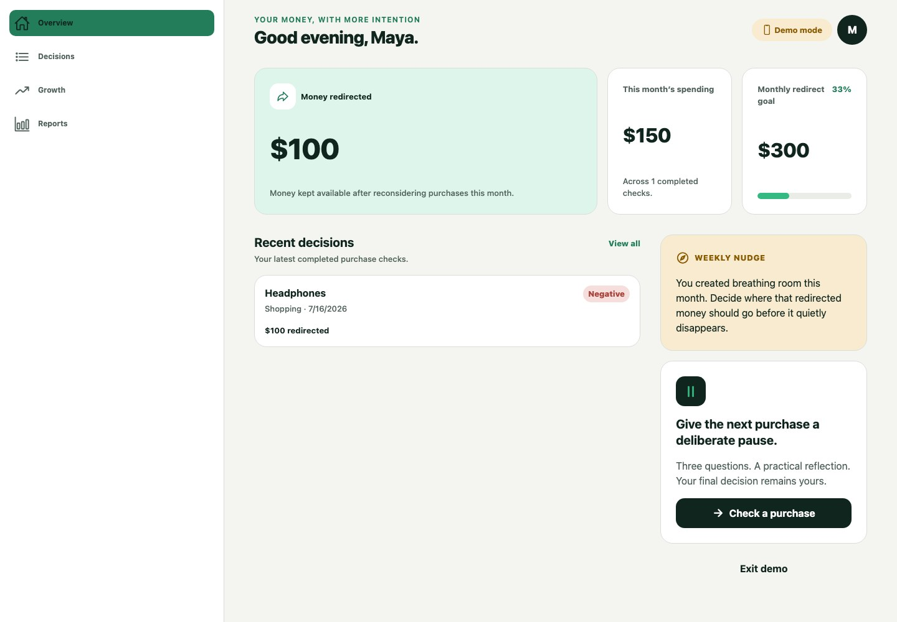
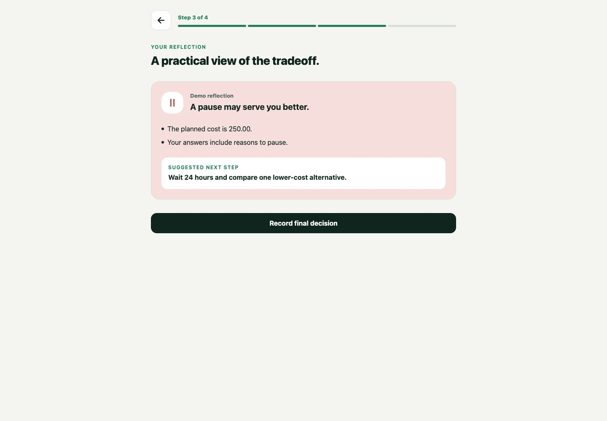

<div align="center">
  
  <h1>NudgeFund</h1>
  <p>Pause before you buy, think it through, and see what that money could do instead.</p>
</div>

[](https://github.com/shlokbhutani13/nudgefund/actions/workflows/ci.yml)

NudgeFund is a personal finance app for impulse purchases. Before you buy something, it asks you three quick questions, gives you a short coaching reply, and then tracks what you actually decided. It runs on web, iPhone and Android from one codebase.

**Try it:** [nudgefund.vercel.app](https://nudgefund.vercel.app/). Click **Explore demo**, no account needed.

| Sign in or try the demo | Your monthly decisions |
| --- | --- |
|  |  |

| The purchase check |
| --- |
|  |

## How it works

1. Enter what you want to buy and how much it costs.
2. Answer three questions: do you need it, what are the alternatives, and what's the trade-off.
3. Read a short coaching reply.
4. Record what you actually spent.

The dashboard then shows your spending, the money you kept, progress toward your goal, and a monthly report.

## Two modes

| | Demo | Signed in |
| --- | --- | --- |
| Account | Not needed | Email and password (Supabase) |
| Where data lives | Your browser or phone only | Postgres, private to you |
| Coaching | Built-in replies | Gemini, with built-in replies as a backup |

In demo mode nothing leaves your device and no AI is called.

## Built with

- Expo 58, React Native and TypeScript, with Expo Router
- Supabase Auth, Postgres with row-level security, and an Edge Function for the AI coach
- Gemini 2.5 Flash Lite, called only from the Edge Function so the API key never reaches the app
- A limit of 12 AI requests per user per hour

The screens never talk to Supabase directly. They go through small data and coaching interfaces, so the same screens work in demo mode and signed-in mode. More in [docs/ARCHITECTURE.md](docs/ARCHITECTURE.md).

## Run it locally

You need Node.js 22.

```bash
git clone https://github.com/shlokbhutani13/nudgefund.git
cd nudgefund/react-expo-app
npm ci
npm run web
```

Open the link Expo prints and choose **Explore demo**. No setup needed. Use `npm run ios` or `npm run android` for phones.

To use real accounts and AI coaching, connect your own Supabase project. The steps are in [DEPLOYMENT.md](DEPLOYMENT.md).

## Tests

```bash
cd react-expo-app
npm test
npm run lint
npm run typecheck
npm run test:e2e
```

That's 36 unit tests plus browser tests. The browser tests go through the whole demo on desktop, a phone-sized screen and dark mode. CI also runs a security audit, Expo Doctor and a type check on the Edge Function.

## Privacy

Signed-in users can only see their own data. NudgeFund is for learning and reflection, not financial, tax or investment advice. See [SECURITY.md](SECURITY.md) and [docs/PRIVACY.md](docs/PRIVACY.md).

## Who built it

**Rahul Rajkumar** came up with the idea and the first version. **Shlok Bhutani** led the rebuild: security, architecture, testing and getting it ready to deploy.

## License

[MIT](LICENSE)
