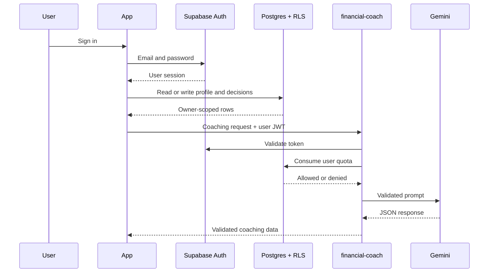

# Architecture

NudgeFund keeps product UI separate from storage and AI providers. That split lets the same screens run as a credential-free demo or a connected Supabase application.

## Client layers

### Routes

`react-expo-app/app` contains Expo Router layouts and thin route components. Routes load data, handle navigation, and pass repositories or view data into feature components.

### Features

`react-expo-app/features` contains:

- Authentication views
- Dashboard presentation
- Purchase decision domain and wizard
- Decision history
- Growth projections
- Monthly reports
- Financial coaching contracts

Feature views do not import Supabase.

### Services

`AppServicesContext` selects implementations from the current auth mode:

```text
demo
  LocalDecisionRepository
  LocalProfileRepository
  DeterministicCoach

connected
  SupabaseDecisionRepository
  SupabaseProfileRepository
  SupabaseCoach
```

Native storage uses AsyncStorage. Web storage uses `localStorage`. Static rendering starts with a memory-safe adapter so Expo can export routes without browser globals.

## Connected request flow



## Data model

### `public.profiles`

One row per authenticated user:

- Display name
- ISO-style three-letter currency code
- Monthly redirect goal

### `public.purchase_decisions`

Stores:

- Original item, amount, and category
- Three questions and answers
- Verdict and recommendation
- Final item and amount
- Database-generated redirected amount
- Timestamps

### `private.ai_usage_events`

Stores authenticated request timestamps for the hourly quota. Client roles receive no schema or table access.

## Security boundaries

- The browser or mobile app receives only public Supabase configuration.
- Postgres policies compare row ownership with `(select auth.uid())`.
- The quota function derives the caller from `auth.uid()`.
- The Edge Function requires a user JWT.
- Gemini and privileged secrets remain in the Edge Function environment.
- AI inputs and outputs pass explicit length, amount, enum, and shape validation.

## Failure behavior

- Missing public Supabase configuration leaves demo mode available.
- Network or Gemini unavailability falls back to deterministic coaching.
- Authentication and rate-limit failures remain visible to the user.
- Repository errors show retry states.
- Decision creation calls `onComplete` once while the save button is disabled.
